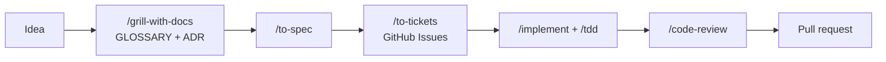

<h1 align="center">Hi there, I'm Son Do 👋</h1>
<h3 align="center">Full-stack Software Engineer · On the path to Cloud Engineering ☁️</h3>

  
  
  
  

  

---

## 🧑‍💻 About me

- 🛠️ Full-stack engineer building web apps end to end: **Java / Spring Boot**, **Node.js / NestJS**, **Python / Django** on the back end and **React / Next.js / Vue** on the front end.
- 🗄️ Comfortable with relational and NoSQL data stores: **PostgreSQL, MySQL, SQL Server, MongoDB, Redis**.
- 🐳 Containerize and ship with **Docker, Docker Compose, Nginx**, deploy to **Vercel** and **Cloudflare**.
- ☁️ Currently growing toward **Cloud Engineering**: cloud infrastructure, container orchestration, Infrastructure as Code and CI/CD.
- 📫 Reach me at **sondoquang3@gmail.com**.

## 🧰 Tech stack

**Languages**

  

**Back end**

  

**Front end**

  

**Databases & BaaS**

  

**DevOps & Hosting**

  

**AI-assisted engineering**

  
  
  
  
  
  

I build with coding agents every day, using a spec-driven workflow rather than vibe coding:

- 🧭 **Workflow:** [mattpocock/skills](https://github.com/mattpocock/skills) on Claude Code and Codex. Align with `/grill-with-docs`, write a spec with `/to-spec`, split it into GitHub Issues with `/to-tickets`, then build with `/implement` + `/tdd` (red-green-refactor). After that: `/diagnosing-bugs`, `/code-review` and `/improve-codebase-architecture`.
- 📚 **Context engineering:** projects ship `CLAUDE.md` / `AGENTS.md` agent rules, a `GLOSSARY.md` shared domain language and ADRs in `docs/adr`, so agents and humans use the same terms and decisions.
- 🎫 **Issue-driven agents:** GitHub Issues through the `gh` CLI, with triage labels (`needs-triage`, `ready-for-agent`, `ready-for-human`) that decide what an agent picks up and what needs a human.
- 🧩 **Domain skills:** per-project skills pinned in `skills-lock.json`, e.g. Anthropic `frontend-design`, Emil Kowalski animation/design skills, NestJS, Django REST Framework and WordPress skills.
- ✅ **Feedback loops:** static types, automated tests (pytest, Jest, Playwright) and browser checks, so agents verify their own work before review.

**Currently learning**

  

## 🚀 Featured projects

| Project | Description | Stack |
| --- | --- | --- |
| [**solar-hub-fullstack**](https://github.com/sondoquang/solar-hub-fullstack) | Centralized admin hub that aggregates multiple WooCommerce stores: order sync, product CRUD, site monitoring | Django REST · Celery · Redis · PostgreSQL · React · Docker |
| [**excel-validator-fullstack**](https://github.com/sondoquang/excel-validator-fullstack) | Excel validation, duplicate detection and data transformation app | Django REST · Celery · PostgreSQL · React · Docker · Nginx |
| [**postgres-replication-lab**](https://github.com/sondoquang/postgres-replication-lab) | Hands-on lab for PostgreSQL primary/standby streaming replication | PostgreSQL · Docker Compose · Shell |
| [**laptopshop-web**](https://github.com/sondoquang/laptopshop-web) | Laptop shop web app with authentication and session management | Spring Boot · Spring MVC · Spring Security · JPA · MySQL |
| [**bookstore-backend**](https://github.com/sondoquang/bookstore-backend) + [**bookstore-frontend**](https://github.com/sondoquang/bookstore-frontend) | Bookstore: REST API with JWT auth and Swagger docs, plus an admin/client SPA | Spring Boot · Spring Security · JWT · SQL Server · React · Redux Toolkit · Ant Design |
| [**sondoit-portfolio-web**](https://github.com/sondoquang/sondoit-portfolio-web) | Personal portfolio site, [live demo](https://sondoitportfolio.vercel.app) | React · Vite · Tailwind CSS · Vercel |

## 📊 GitHub stats

  <picture>
    <source media="(prefers-color-scheme: dark)" srcset="https://github-readme-stats.vercel.app/api?username=sondoquang&show_icons=true&rank_icon=github&hide_border=true&theme=github_dark" />
    
  </picture>
  <picture>
    <source media="(prefers-color-scheme: dark)" srcset="https://github-readme-stats.vercel.app/api/top-langs/?username=sondoquang&layout=compact&langs_count=8&hide_border=true&theme=github_dark" />
    
  </picture>

  <picture>
    <source media="(prefers-color-scheme: dark)" srcset="https://streak-stats.demolab.com?user=sondoquang&hide_border=true&theme=github-dark-blue" />
    
  </picture>

